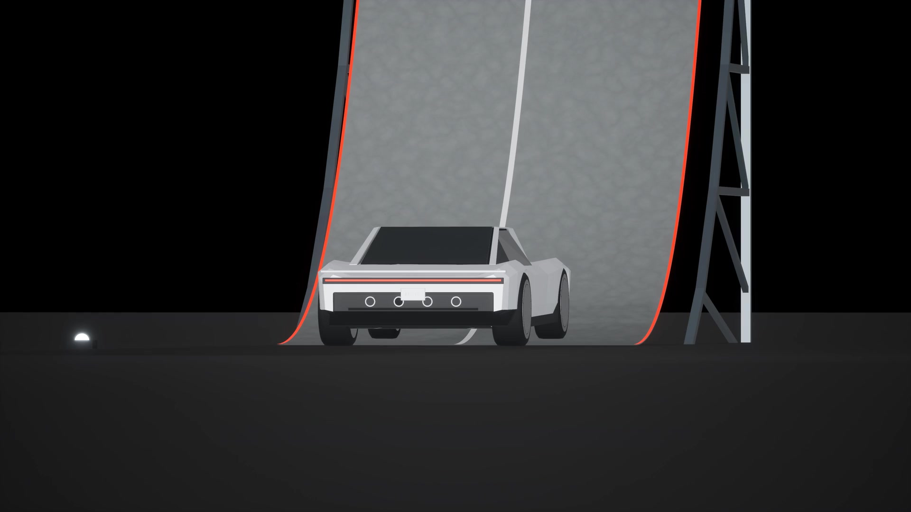
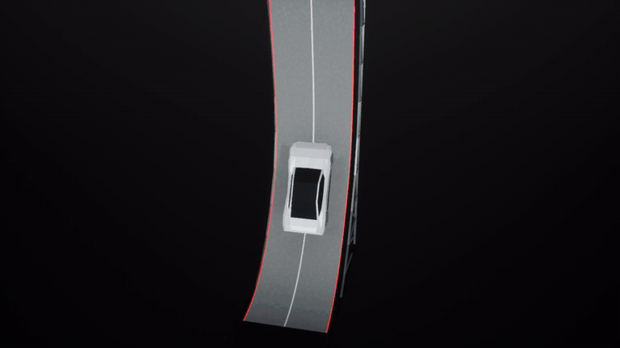
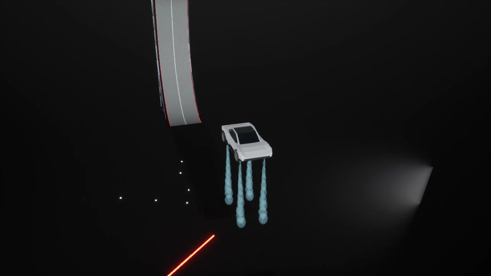

# ROADSTER V2

**坡道、翻转、落地——在 Unreal Engine 里逐帧拆开看。**  
An editable 3D study of the Roadster ramp demonstration in **Unreal Engine 5.4.3**.

[](Renders/Roadster_V2_Showcase.mp4)

**[▶ 23 秒演示 / Watch the showcase](Renders/Roadster_V2_Showcase.mp4)** · [完整 4K 回放 / Full 4K replay](Renders/Reference_Replay_4K.mp4) · [打开工程 / Get started](#打开--get-started)

> **复现草稿 / Reconstruction draft.** 关键帧回放，车辆动力学未验证；6 个稀疏轮廓样本平均 IoU **0.693**，未达 **0.90**。非官方 CAD。  
> Keyframed motion; vehicle physics unvalidated. Six-sample silhouette IoU **0.693 / 0.90 target**. Unofficial, independently authored geometry.

## 先看它动起来 / Motion preview



*7.5 秒真实渲染片段，来自三维检查镜头；保持原速。 / A 7.5-second excerpt from the rendered inspection view, at original speed.*

| 可编辑场景 / Editable scene | 可检查运动 / Inspectable motion | 原创渲染 / Authored renders |
|---|---|---|
| 车辆、坡道、材质、相机 / Vehicle, ramp, materials, cameras | 419 帧 · 逐帧与跳转 / 419 frames · frame stepping and seeking | 4K 回放 + 独立三维检查视角 / 4K replay + separate inspection view |

## 工程内容 / What is inside

这是独立制作的三维外观模型、坡道、相机与关键帧运动研究，非 Tesla 官方项目、CAD 或完整物理复原。序列为 **419 帧、24000/1001 fps、17.475792 秒**；模型和场景均为三维资产，没有用参考视频平面代替车辆运动。

An independently authored exterior model, ramp, cameras and keyed motion study—not official Tesla CAD or a complete physics reconstruction. The editable sequence contains **419 frames at 24000/1001 fps (17.475792 s)**. It uses actual 3D geometry rather than a reference-video plane.

## 打开 / Get started

需要 **Unreal Engine 5.4.3（Windows）**。双击 [Roadster_Demo_Reconstruction.uproject](Roadster_Demo_Reconstruction.uproject) 或 `Open_Project.cmd`。在 Content Browser 打开 `/Game/Sequences/SEQ_Ramp_Draft`，用 Sequencer 播放、暂停、逐帧和跳转；解除 Camera Cuts 锁定后可自由检查场景。

Install **Unreal Engine 5.4.3 on Windows**, then open the project or run `Open_Project.cmd`. Open `/Game/Sequences/SEQ_Ramp_Draft` in Sequencer for playback, seeking and frame stepping. Unlock Camera Cuts to inspect the scene freely.

```powershell
# Optional when UE is installed elsewhere / 非标准安装位置时设置
$env:UE_ROOT = 'D:\Epic Games\UE_5.4'
.\Scripts\Run.ps1 -Action Open
.\Scripts\Run.ps1 -Action Play
```

`Content/` 包含保存的地图和序列；`Data/` 包含轨迹与相机数据；`AssetsSource/` 包含可编辑 Blender/FBX；`Scripts/` 包含生成与渲染入口。详细依赖和重建步骤见 [Getting started](docs/getting_started.md)。

`Content/` holds saved native maps/sequences, `Data/` holds motion/camera parameters, `AssetsSource/` holds editable Blender/FBX models, and `Scripts/` provides build/render entry points. See [Getting started](docs/getting_started.md).

## 原创演示 / Rendered previews

- [23-second showcase / 23秒展示剪辑](Renders/Roadster_V2_Showcase.mp4)
- [4K replay / 4K自制回放](Renders/Reference_Replay_4K.mp4)
- [1080p replay / 1080p自制回放](Renders/Reference_Replay_1080.mp4)
- [3D inspection / 三维检查镜头](Renders/Inspection_3D.mp4)

这些视频由本工程渲染，不含官方原片或叠加对比。 / These videos are rendered from this project and contain no official footage or reference overlays.

[](Renders/Inspection_3D.mp4)

展示剪辑在完整回放后接入同一动作的 6 秒检查视角，并标注 **3D INSPECTION REPLAY**；不代表第二次动作。封面、动图和剪辑均取自已验证的原创渲染，仅调整展示方式，不是新的精度或物理验收。检查镜头原生 720p，在展示剪辑中放大至 1080p。[媒体来源与处理记录](docs/media/provenance.json)。

The showcase appends a labelled 6-second inspection replay of the same action. Stills, GIF and showcase derive from the existing authored renders; this presentation update is not a new fidelity or physics validation. The inspection segment is upscaled from native 720p. [Media provenance](docs/media/provenance.json).

## 已测结果与边界 / Measured results and limits

| 本地已测版本 / Locally evaluated build | 结果 / Result |
|---|---|
| 6 个稀疏轮廓 / Six sparse silhouettes | Mean IoU **0.693439**; **0/6** reached 0.90 |
| 21 个清晰中心样本 / 21 clear center samples | Mean error **0.2177%** of the 1920×1080 diagonal |
| 原生播放 / Native playback | Saved-map reopen, native replay controls and packaged Windows autoplay/loop tested locally |

中心样本共享拟合相机与几何，**不是盲测**；稀疏均值不代表全片高保真通过。初趟爬升、倒挂停留与倒退未覆盖；接触/触地时刻、车身细节与气流仍不确定。独立重力方块测试不是车辆动力学证明。

These samples share fitted cameras/geometry and are **not a blind test**. Sparse center agreement does not establish full-sequence fidelity. The earlier climb, inverted hold and reverse descent are outside scope; exact contact/landing, vehicle details and gas effects remain uncertain. A separate gravity-box test is not vehicle-physics validation. See [Validation and limitations](docs/validation.md).

公开副本另行清理了本机路径与导入元数据，并实际重开验证144/240帧；这不是一次新的画质重测。 / The public copy separately removes local paths/import metadata and was reopened to check frames 144/240; this is not a new fidelity measurement. See [Public-copy preparation](docs/public_copy.md).

## 官方参考与公开范围 / References and public subset

参考：[Tesla — The Ramp](https://www.youtube.com/watch?v=7p5LxFdc-Qg)、[官方 X 视频](https://x.com/Tesla/status/2110913438293647789)、[Roadster Event](https://www.youtube.com/watch?v=qt5p-_tE8d0)。[Sources and scope](docs/sources_and_scope.md) 说明时间基准及其他参考。

本公开子集不包含官方原片、产品图、参考帧/遮罩、对比视频或本机日志；公开可观看不等于获得再分发许可。这里只链接官方来源供研究。仓库未添加开源许可证或授予第三方素材许可。

This public subset omits official media, product images, reference frames/masks, comparison videos and local logs. Public viewing does not establish redistribution permission; official sources are linked for research. No open-source license or third-party media license is granted here.
